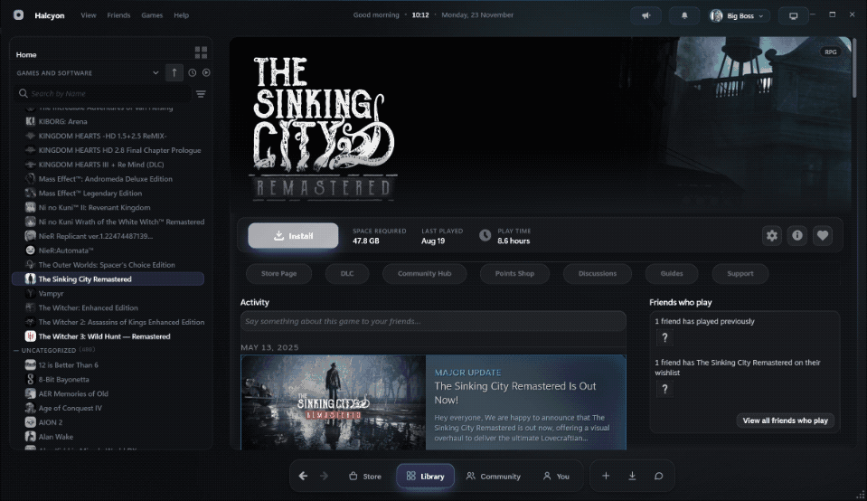
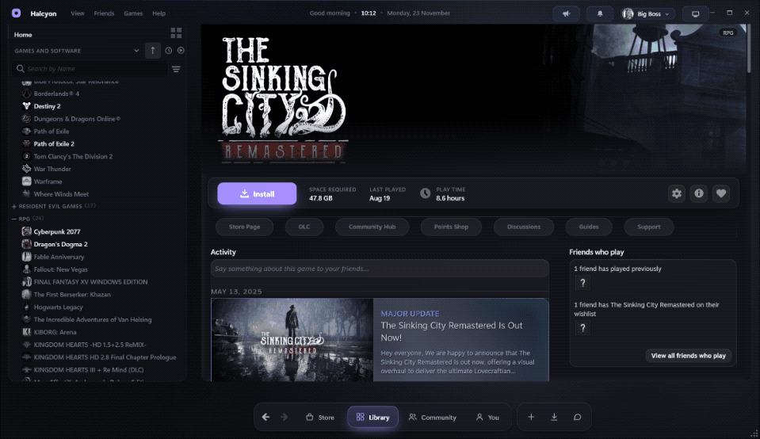

# Halcyon

**A calm, premium redesign of Steam.** A Steam client theme for [Beyond Steam](https://github.com/OriginalSwayze/Beyond-Steam) and [Millennium](https://steambrew.app).

- **Soft layered glass.** The game list and the page are two frosted cards with lit top edges and deep, soft shadows, floating with room to breathe.
- **A floating dock.** Store, Library, Community and You sit in a dock at the bottom centre with drawn icons; a lit pill glides to the current one on a spring. Add game, downloads and friends sit in a second, smaller dock beside it.
- **Ambient light.** On a game page the whole window takes on the colours of that game's artwork, blurred far behind the glass and cross-faded as you move between games. Elsewhere two slow aurora washes drift in your accent colour.
- **Motion that feels physical.** Spring easing on the dock, covers, buttons and toggles; pages settle in with a short fade and focus pull; menus and notifications pop into place.
- **Quiet type.** Segoe UI Variable throughout, tight display headings, no shouting uppercase.
- **A greeting in the title bar** (good evening, the time, the date, and whether something is downloading) and an opening where the wordmark catches the light.
- Matching menus, notifications, sign-in, friends list, settings and Store/Community pages.

## Install

- **With [Beyond Steam](https://github.com/OriginalSwayze/Beyond-Steam) (easiest):** in Steam press **Ctrl+Shift+B**, open
  **Get more** and install **Halcyon**.
- **By hand:** download **Halcyon.zip** from the [latest release](https://github.com/OriginalSwayze/Halcyon/releases/latest) and unzip
  it into `%APPDATA%\Beyond Steam\themes\Halcyon` (Beyond Steam) or `Steam\millennium\themes\Halcyon` (Millennium).

## Options

In Beyond Steam's **Theme options** tab (or **Millennium → Themes → Halcyon**) you can change:

Accent colour (Iris, Azure, Mint, Coral, Rose, Mono) · Surfaces (Midnight, Graphite, OLED) · Ambient light (Artwork, Aurora only, Off) · Ambient strength · Film grain · Panel transparency · Glass blur · Corner radius · Density · What's New · Readout · Startup screen · Motion · Cover hover · Cursor light · Privacy · Contrast · Focus rings · Text size

Everything here is original: no other game's names, logos, art or fonts. Fonts are ones that ship with Windows.

## License

MIT, see [LICENSE](LICENSE).
